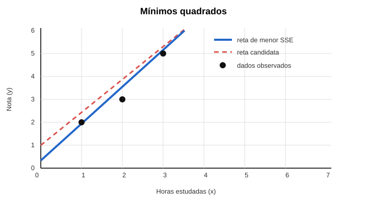

# O que é um problema de regressão?

> Versão didática: os conceitos matemáticos são apresentados com exemplos pequenos e visualizações antes da formalização.

## 1. Definição intuitiva

Um problema de regressão ocorre quando queremos estimar um **valor numérico** a partir de informações observadas.

Exemplos:

- prever o preço de um imóvel;
- estimar o consumo de energia;
- prever vendas;
- estimar o tempo de entrega;
- prever a latência de uma API;
- estimar o valor financeiro de uma transação;
- prever a demanda de um serviço.

Em Machine Learning, o conjunto de entradas é representado por `X`, e o valor que queremos prever por `Y`:

```text
X → Y
```

O objetivo é aprender uma função:

```text
Ŷ = f(X)
```

O NIST define regressão como uma técnica estatística para estimar relações entre uma variável dependente e uma ou mais variáveis explicativas. Em ML, a variável-alvo normalmente possui rótulo numérico.

Fonte: [NIST — Regression](https://csrc.nist.gov/glossary/term/regression)

## 2. Definição estatística

Uma forma geral de representar um problema de regressão é:

```text
Y = f(X) + ε
```

Onde:

- `Y` é o valor observado;
- `f(X)` é o padrão que queremos aprender;
- `ε` representa ruído, incerteza ou fatores não observados.

Em muitos casos, o objetivo é estimar o valor esperado:

```text
E[Y | X = x]
```

Isso significa: dado um conjunto de características `X = x`, qual é o valor médio esperado para `Y`? Essa interpretação é central na teoria estatística da regressão.

Fonte: [Harvard — Introduction to Regression](https://rafalab.dfci.harvard.edu/dsbook-part-2/linear-models/regression.html)

### Exemplo simples de função

Considere a função:

```text
f(x) = 2x + 1
```

Aqui:

- `x` é a entrada;
- `2` indica quanto o resultado aumenta quando `x` aumenta uma unidade;
- `1` é o valor inicial;
- `f(x)` é o resultado produzido pela função.

Se `x = 3`:

```text
f(3) = 2 × 3 + 1
f(3) = 6 + 1
f(3) = 7
```

Em uma aplicação de ML, a função não é conhecida de antemão. O treinamento tenta aprender os valores dos parâmetros a partir dos exemplos observados.

## 3. Como essa perspectiva nasceu?

### Astronomia e medições imperfeitas

A regressão surgiu de um problema prático: cientistas precisavam combinar observações imperfeitas para estimar trajetórias, posições e órbitas.

No início do século XIX, Adrien-Marie Legendre publicou, em 1805, o método dos **mínimos quadrados** para ajustar equações às observações de órbitas de cometas. Carl Friedrich Gauss publicou uma formulação própria em 1809 e relacionou o método a uma interpretação probabilística dos erros.

Fonte: [Regression with R — Historical perspective](https://rwr.nrhstat.org/1_introduction.html)

A ideia era encontrar os parâmetros que minimizassem a soma dos erros ao quadrado:

```text
min Σ(yi - ŷi)²
```

Para uma regressão linear simples:

```text
ŷ = β₀ + β₁x
```

O modelo procura a reta que melhor representa os dados segundo esse critério.

### Exemplo concreto de mínimos quadrados

Imagine os seguintes dados de estudo:

| Horas estudadas (`x`) | Nota real (`y`) |
|---:|---:|
| 1 | 2 |
| 2 | 3 |
| 3 | 5 |

Vamos testar a reta:

```text
ŷ = x + 1
```

O símbolo `ŷ` significa “valor previsto”.

| Horas | Nota real | Nota prevista | Erro `y - ŷ` | Erro² |
|---:|---:|---:|---:|---:|
| 1 | 2 | 2 | 0 | 0 |
| 2 | 3 | 3 | 0 | 0 |
| 3 | 5 | 4 | 1 | 1 |

A soma dos erros quadrados é:

```text
SSE = 0² + 0² + 1²
SSE = 1
```

Agora testamos outra reta:

```text
ŷ = 1,5x + 0,333
```

| Horas | Nota real | Nota prevista | Erro | Erro² |
|---:|---:|---:|---:|---:|
| 1 | 2 | 1,833 | 0,167 | 0,028 |
| 2 | 3 | 3,333 | -0,333 | 0,111 |
| 3 | 5 | 4,833 | 0,167 | 0,028 |

Neste caso:

```text
SSE ≈ 0,028 + 0,111 + 0,028
SSE ≈ 0,167
```

Como `0,167` é menor que `1`, a segunda reta é melhor segundo o critério dos mínimos quadrados.

### Visualização do exemplo



No gráfico:

- o eixo horizontal representa as horas estudadas (`x`);
- o eixo vertical representa a nota (`y`);
- os pontos pretos são os dados observados;
- a linha vermelha tracejada é a primeira reta testada;
- a linha azul é a reta com menor soma de erros quadrados entre as duas comparadas.

O gráfico mostra que a linha azul não precisa passar exatamente por todos os pontos. Ela procura um equilíbrio geral que reduza os erros quadráticos. O gráfico também não prova que estudar mais causa uma nota maior; ele apenas representa a relação observada nesses dados.

### Por que elevar o erro ao quadrado?

O quadrado tem duas funções:

1. transformar erros negativos em positivos;
2. penalizar mais fortemente erros grandes.

Por exemplo:

```text
erro 1  → erro² 1
erro 2  → erro² 4
erro 5  → erro² 25
```

Se apenas somássemos os erros, estes valores poderiam cancelar:

```text
+2 + (-2) + 0 = 0
```

Mas o modelo teria cometido dois erros relevantes. Com o quadrado:

```text
2² + (-2)² + 0² = 8
```

### O que o algoritmo faz?

Sem usar cálculo diferencial, podemos imaginar o treinamento assim:

```text
1. Escolher uma possível reta.
2. Calcular as previsões.
3. Calcular os erros.
4. Elevar os erros ao quadrado.
5. Somar os resultados.
6. Ajustar a reta para reduzir essa soma.
7. Repetir até encontrar uma solução muito boa.
```

O cálculo diferencial pode ser usado para encontrar matematicamente o ponto mínimo, mas você não precisa dominar cálculo para entender a ideia. Bibliotecas como scikit-learn fazem essa etapa automaticamente.

### Interpretação dos parâmetros

Na equação:

```text
ŷ = β₀ + β₁x
```

- `β₀` é o intercepto: a previsão quando `x = 0`;
- `β₁` é a inclinação: quanto a previsão tende a mudar quando `x` aumenta uma unidade.

Na reta `ŷ = 1,5x + 0,333`, a interpretação aproximada é que cada hora adicional de estudo está associada a um aumento de 1,5 ponto na nota prevista. Isso é uma associação observada pelo modelo, não uma prova de causalidade.

### Origem do termo “regressão”

O termo “regressão” ficou associado aos estudos de Francis Galton sobre a altura de pais e filhos. Ele observou que filhos de pais muito altos tendiam, em média, a ser um pouco mais baixos que os pais, enquanto filhos de pais muito baixos tendiam a ser um pouco mais altos.

Galton chamou esse fenômeno de **regressão em direção à média**. Posteriormente, o termo passou a ser utilizado para métodos estatísticos mais gerais.

Fonte: [Francis Galton Bibliography — 1886 paper](https://galton.org/bibnew/papers.html)

É importante separar as duas ideias:

- **regressão à média** é um fenômeno estatístico;
- **análise de regressão** é um conjunto de métodos para estudar relações e fazer previsões.

## 4. Principais formas de aplicar regressão

### Regressão linear

Usada quando uma relação aproximadamente linear é suficiente:

```text
preço = β₀ + β₁(área) + β₂(quartos)
```

Aplicações:

- preço de imóveis;
- custo de infraestrutura;
- previsão de vendas;
- consumo de energia;
- estimativa de capacidade.

### Regressão múltipla

Utiliza várias variáveis de entrada para prever um resultado:

```text
demanda = f(preço, promoção, clima, dia da semana)
```

Esse é o cenário mais comum em aplicações reais.

### Regressão polinomial

Adiciona termos não lineares, como:

```text
ŷ = β₀ + β₁x + β₂x²
```

Pode ser útil para representar crescimento, degradação de componentes, consumo conforme temperatura e desempenho conforme carga.

### Regressão regularizada

A regressão pode receber penalizações para reduzir complexidade e overfitting:

- **Ridge** — regularização L2;
- **Lasso** — regularização L1;
- **Elastic Net** — combinação de L1 e L2.

Essas técnicas são úteis quando existem muitas variáveis ou forte correlação entre elas.

Fonte: [An Introduction to Statistical Learning](https://www.statlearning.com/home)

### Árvores e ensembles

Modelos como Decision Tree Regressor, Random Forest, Gradient Boosting, XGBoost e LightGBM são apropriados quando as relações entre as variáveis são complexas e não lineares.

Aplicações:

- previsão de demanda;
- valor de transações;
- tempo de processamento;
- risco financeiro;
- consumo de recursos;
- capacidade necessária de servidores.

### Séries temporais

Quando o tempo influencia o resultado, usamos regressão com variáveis temporais ou modelos específicos de séries temporais.

Aplicações:

- vendas futuras;
- tráfego;
- volume de transações;
- latência de sistemas;
- consumo de energia;
- chamados de suporte.

Nesse cenário, não devemos dividir os dados aleatoriamente sem analisar o risco de usar informações do futuro no treinamento.

### Regressão quantílica

Em vez de prever apenas a média, o modelo prevê percentis.

Exemplos:

- previsão mediana de demanda;
- limite superior de consumo;
- pior cenário operacional;
- intervalo esperado de atraso.

É útil quando a média não representa adequadamente o risco.

## 5. Como avaliar um modelo de regressão?

As principais métricas são:

- **MAE**: erro absoluto médio;
- **MSE**: erro quadrático médio;
- **RMSE**: raiz do erro quadrático médio;
- **MAPE**: erro percentual médio;
- **R²**: proporção da variabilidade explicada pelo modelo.

A escolha depende do problema:

- MAE é simples de interpretar;
- RMSE penaliza mais os erros grandes;
- MAPE facilita a comunicação percentual, mas pode ser inadequado quando o valor real é zero ou muito próximo de zero;
- R² ajuda a analisar o ajuste, mas não deve ser usado sozinho.

Fonte: [NIST/SEMATECH Engineering Statistics Handbook](https://www.nist.gov/programs-projects/nistsematech-engineering-statistics-handbook)

### Exemplo numérico das métricas

Suponha que os valores reais sejam:

```text
real     = [100, 120, 80]
previsto = [90,  130, 100]
```

Os erros absolutos são:

```text
|100 - 90|  = 10
|120 - 130| = 10
|80 - 100|  = 20
```

O **MAE** é a média desses erros:

```text
MAE = (10 + 10 + 20) / 3
MAE = 13,33
```

Agora os erros quadráticos:

```text
10² = 100
10² = 100
20² = 400
```

O **MSE** é:

```text
MSE = (100 + 100 + 400) / 3
MSE = 200
```

O **RMSE** é a raiz quadrada do MSE:

```text
RMSE = √200 ≈ 14,14
```

O MAE responde “qual é o erro médio em unidades originais?”. O RMSE dá mais peso ao erro de 20, porque ele foi elevado ao quadrado.

## 6. Regressão não é causalidade

Uma regressão pode identificar uma associação ou produzir boas previsões, mas isso não prova que uma variável causa outra.

Por exemplo, pode existir associação entre:

- quantidade de servidores;
- número de incidentes;
- volume de requisições.

Isso não significa necessariamente que aumentar servidores cause mais incidentes. Talvez sistemas maiores tenham simultaneamente mais servidores, mais usuários e mais complexidade.

A regressão pode responder:

> Qual valor espero observar dado este conjunto de características?

Mas não responde automaticamente:

> O que acontecerá se eu intervier deliberadamente em uma variável?

Essa distinção entre associação, previsão e causalidade é fundamental em estatística aplicada.

Fonte: [Berkeley — Regression estimates and conditional expectations](https://statistics.berkeley.edu/sites/default/files/tech-reports/408.pdf)

## 7. Relação com o estudo de Machine Learning

Para a transição para ML Engineering, regressão é importante porque introduz:

- função de perda;
- erro de previsão;
- resíduos;
- generalização;
- overfitting;
- bias e variance;
- regularização;
- validação;
- escolha de métricas;
- interpretação de modelos.

Além disso, a regressão logística faz a ponte para classificação: apesar do nome “regressão”, ela é usada para estimar probabilidades de classes.

## 8. Sequência teórica recomendada

1. Variável-alvo e variáveis explicativas.
2. Relação entre associação e previsão.
3. Erro e resíduos.
4. Mínimos quadrados.
5. Regressão linear simples.
6. Regressão linear múltipla.
7. Hipóteses e limitações.
8. Overfitting e regularização.
9. Métricas de regressão.
10. Validação e generalização.
11. Regressão logística como ponte para classificação.
12. Modelos não lineares e ensembles.

## Próximo ponto para debate

Por que usamos o quadrado dos erros na regressão linear e o que muda quando existem outliers?

## Fonte principal

- [James et al. — An Introduction to Statistical Learning](https://www.statlearning.com/home)
- [NIST — Regression Glossary](https://csrc.nist.gov/glossary/term/regression)
- [Regression with R — A brief history of regression](https://rwr.nrhstat.org/1_introduction.html)
